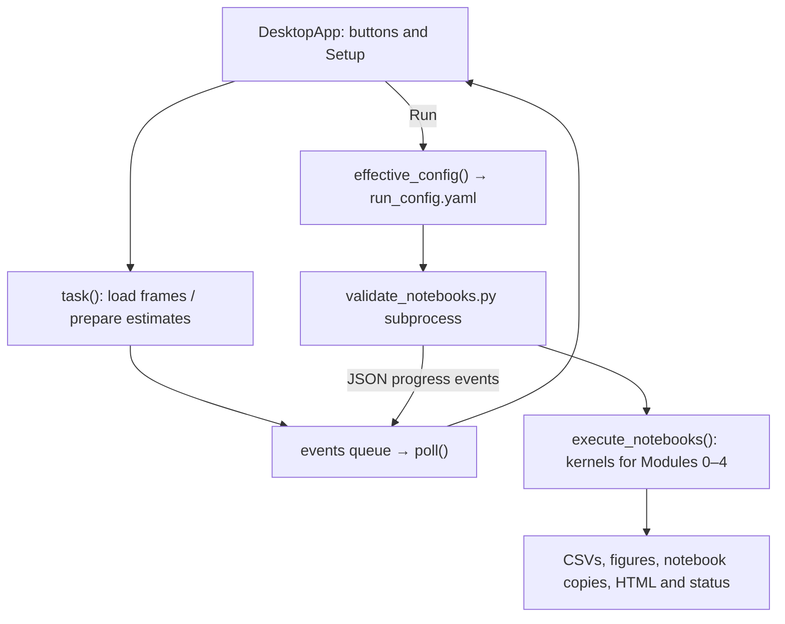

# PSIB project documentation

This document describes the current implementation, how its parts connect, and
how to run and maintain it. Start with [README.md](README.md) for quick setup.
For a first GUI run, follow [the guided walkthrough](#3-desktop-workflow-a-guided-walkthrough).
For implementation details, see [the function map](#51-functions-behind-the-buttons)
and [how the frontend is built](#55-frontend-structure-and-layout).

## Contents

| Read this for… | Section |
| --- | --- |
| Scope and limitations | [1. Purpose and current state](#1-purpose-and-current-state) |
| Linux/Windows setup and notebook execution | [2. Installation and entry points](#2-installation-and-entry-points) |
| Using the app, reviewing results and editing explanations | [3. Desktop workflow](#3-desktop-workflow-a-guided-walkthrough) |
| Settings, precedence and coordinate inputs | [4. Configuration](#4-configuration-and-precedence) |
| Callbacks, state, layout and rendering | [5. Architecture](#5-architecture-and-data-flow) |
| Tracking, segmentation and response estimates | [6. Measurement](#6-tracking-segmentation-and-measurement) |
| Run folders, tables and provenance | [7. Outputs](#7-outputs-and-provenance) |
| Checks, latest run evidence and common failures | [8. Testing and troubleshooting](#8-testing-and-troubleshooting) |
| Generated files and repository cleanup | [9. Maintenance](#9-maintenance-and-debloat-policy) |
| Compression algorithms and downstream comparisons | [10. Compression](#10-module-4-compression-and-downstream-measurements) |
| GPU scope and fallback diagnostics | [11. OpenCL](#11-optional-opencl-gpu-requests) |

Sections 2–4 cover operation; Sections 5–6 explain implementation and measurement.
Sections 10–11 provide focused references for compression and acceleration.

## 1. Purpose and current state

The project measures an eye's pupil response to a light change. It follows the
PSIB practical guide and keeps image-processing experiments in notebooks while
reusable algorithms live in Python modules.

| Module | Implemented responsibilities | Important qualification |
| --- | --- | --- |
| 0: acquisition | Inventory recordings, inspect timestamps and brightness; preview images from the selected video | Inventory and brightness checks can include the input folder, while the contact sheet shows only the selected video |
| 1: image fundamentals | Sampling, quantization, color spaces, intensity transforms, noise/filtering, edges, Fourier and image-quality metrics | These experiments illustrate methods; a higher image-similarity score does not establish better pupil detection |
| 2: segmentation | Global/local Otsu, K-means, snakes, watershed, morphology, contour skeletonization and optional reference comparison | Local Otsu is provisional; weak contrast and reflections still affect boundaries |
| 3: features and time | Shape, RGB texture, eye tracking, pupil size curves, artifact handling and response estimates | Physiological measurements remain unvalidated until compared with human references |
| 4: compression | Explicit Huffman and horizontal/vertical RLE, JPEG image comparisons and full-video Q=50/10 measurements | Pipeline differences are not anatomical accuracy; source videos are already compressed |

The desktop app runs Modules 0–4. It simplifies configuration but does not make the
pipeline fully automatic for unseen videos: automatic initialization can need
manual correction, and enabled ROI/calibration options need image selections.
Written notebook discussion answers and broader validation remain work for the
practical assignment. The figure explanations describe how to read the outputs;
they do not complete those discussion answers or validate pupil measurements.

## 2. Installation and entry points

### 2.1 Linux desktop setup

Development uses Linux and Python 3.12. The annotations and GUI code require a
modern Python version; use the tested 3.12 environment rather than assuming the
assignment's older minimum is sufficient.

```bash
python3 -m venv .venv
source .venv/bin/activate
python -m pip install -r requirements.txt
python gui.py
```

Tkinter is provided by the operating system, not pip. On Debian/Ubuntu its package
is `python3-tk`. Folder opening uses the system's `xdg-open` or `gio`. A desktop
display is needed for the app and standalone OpenCV selection windows.

| Entry point | Purpose |
| --- | --- |
| `gui.py` | Start the desktop application with the active Python environment |
| `PSIB.vbs` | Windows first-launch installer and launcher with a hidden console |
| `PSIB.bat` | Windows installer/launcher with visible console output |
| `validate_notebooks.py` | Execute notebooks and preserve executed copies |
| `notebooks/00_…04_*.ipynb` | Run experiments manually in Jupyter |
| `tests/` | Focused automated checks; no real-video anatomical ground truth |

### 2.2 Windows launchers

Install 64-bit Python 3.12 with pip, the `py` launcher and **Tcl/Tk and IDLE**.
Extract or clone the project, then double-click **PSIB.vbs** in the folder
containing `gui.py` and `requirements.txt`. On first launch it displays a setup
notice, creates `.venv` using `py -3.12` and installs the base requirements in
visible console windows. Later launches reuse `.venv/Scripts/python.exe` and hide
the console while the app runs.

The launcher redirects application output to `psib_launch.log`, replacing that
file on each launch. If the app exits with an error, a dialog shows the last part
of the log and its path. Dependency installation failure removes the incomplete
environment so the next launch can retry. Use **PSIB.bat** for visible output or
when VBScript cannot run. Both launchers change to their own directory, so a
shortcut can point to the launcher without manually setting its working folder.
If requirements change, update the environment with pip or remove `.venv` and
launch again; an existing environment is not automatically upgraded.

Manual setup in Windows Command Prompt, from the project folder:

```cmd
py -3.12 -m venv .venv
.venv\Scripts\activate.bat
python -m pip install -r requirements.txt
python gui.py
```

See the [README Windows guide](README.md#windows) for shortcut and installation
troubleshooting. Windows launcher and cancellation behavior still need platform
validation; the latest full notebook run was on Linux.

### 2.3 Notebooks and terminal execution

JupyterLab is optional and is not required by the desktop app or terminal runner.
To install the browser-based editor and launch it from the repository root:

```bash
python -m pip install -r requirements-notebooks.txt
python -m jupyterlab
```

The optional file includes the base requirements. Terminal examples:

```bash
python validate_notebooks.py
python validate_notebooks.py 02_segmentation_morphology.ipynb
python validate_notebooks.py --config /absolute/path/run_config.yaml --json-events
```

The last command executes all notebooks using prepared configuration. Such runs
must contain manual/full-frame ROI settings, numeric pupil seeds (clicked or
GUI-estimated), and ruler points when calibration is enabled;
interactive selection calls are blocked rather than opening unexpected windows.
Jupyter kernels need local communication ports even when no browser is involved.

`--output-dir` changes the destination for executed notebook/report copies. The
configuration's `output_dir` controls processing figures and tables; they are
separate concepts. An explicit configuration outside the project should contain
absolute input/output paths and a `project_root` when project-relative paths are used.

## 3. Desktop workflow: a guided walkthrough

The GUI collects the video and image selections, then starts the existing
notebooks for you. **You do not need to open Jupyter or call Python functions by
hand.** It does not replace the image-processing algorithms inside the notebooks.

### 3.1 What you need before starting

- The project installed following the [README setup instructions](README.md#install-and-open-the-desktop-app).
- A desktop session. On Linux, activate `.venv` and run `python gui.py` from
  the project folder; keep the terminal open. On Windows, launch `PSIB.vbs` or
  `PSIB.bat`, which use the project environment automatically.
- Your video file; videos are not bundled with the repository.
- A visible ruler of known spacing **only if** you want calibrated measurements.
  Without a ruler, turn Calibration off and use pixel measurements.

JupyterLab, a GPU and manually annotated masks are not required for a GUI run.
The GUI supplies the numerical initializations required by Modules 2–4, either
from your clicks or from the optional automatic estimator.

### 3.2 What the screen contains

| Area/control | What it does | What you need to provide |
| --- | --- | --- |
| **Choose video…** | Loads video metadata and any saved profile for that file | One readable video |
| **Primary (s)** / **Secondary (s)** | Choose the two comparison frames | Two different, ordered times within the recording |
| **Apply / load frames** | Loads the chosen frames and prepares their tracked crops/automatic estimates | Click after editing timestamps |
| **Select eye ROI** | On: use a selected moving eye crop. Off: measure full frames | A rectangle only when enabled |
| **Calibration** / **Ruler (cm)** | On: convert pixels to physical units. Off: pixel-only output | Two ruler marks separated by the entered distance when enabled |
| **Advanced options** → **Select pupils manually** | On: you click the pupil seeds. Off: the app estimates them | Center + boundary on each comparison frame, or successful automatic estimates |
| **Advanced options** → **Request GPU (OpenCL)** | Requests supported Module 1 operations on an OpenCL GPU | Nothing to select in the image; read the availability message |
| **Steps** | Checklist of required actions; teal checks mark done, amber marks next, – marks skipped | Click an enabled step to open its control |
| **Go to next step ▶** | Opens the first pending setup control | Starts no analysis; use Run when ready |
| **Hide panel** / **Show panel** | Hides/restores the settings sidebar | Optional, to enlarge the image area |
| **Setup** tab | Shows the image and selection tools | Make or inspect selections here |
| **Results & log** tab | Shows execution messages, figures and notebook reports | Available results from the current session's last run |
| Bottom status / **Run all notebooks (0–4)** | Explains missing setup and starts the complete pipeline when ready | Finish the required setup first |

The settings sidebar scrolls independently; its width can be adjusted by dragging
the divider. Hover over controls for short explanations. The window attempts to
start maximized, while Run/Cancel and status stay in the bottom bar.

The Primary and Secondary times are **comparison timestamps**, not the beginning
and end of a video clip. Modules 3 and 4 still process the whole recording.

### 3.3 First run, step by step

1. **Open the app and choose a video.** Click **Choose video…**, select your file,
   and wait for the dimensions, last-frame time and preview to appear. The first
   scan can take a while because the app decodes the recording. An unchanged
   video's saved settings may be restored automatically.
2. **Check the comparison times.** For A_2, 1 s and 5 s are the existing example
   values; they are not universal settings for every video. Choose a useful early
   frame and a later comparison frame. Both must be within the displayed
   last-frame time. Enter decimals with a dot, then click **Apply / load frames**
   and wait. Editing the text alone does not apply new timestamps.
3. **Choose whether to use an eye ROI.** An ROI means “region of interest”: a
   rectangle around the eye. Leaving **Select eye ROI** on is recommended,
   especially for automatic pupil initialization. Click **1. Eye ROI**, drag a
   rectangle around the entire eye with some surrounding context, and click
   **Confirm selection**. Avoid unrelated dark objects and the ruler where
   practical. Wait while the app follows that eye to the second comparison frame.
   If you turn ROI off, skip drawing the rectangle; measurements use full frames.
4. **Choose whether to calibrate.** If the video has a ruler, enable
   **Calibration** and enter the distance you will mark, normally `1.0` cm. Click
   **2. Ruler endpoints**, click the two ruler marks exactly that distance apart,
   then **Confirm selection**. The selection is on the full primary frame, even
   when the eye ROI is cropped. If there is no ruler, turn Calibration off and
   skip this step. An old scale is not used while calibration is disabled.
5. **Expand Advanced options and choose one pupil-initialization method.** These
   circles initialize the algorithms; they are not the final pupil measurements.

   | Method | What to do |
   | --- | --- |
   | Manual, checkbox on | Click **3. Primary pupil**. Click the pupil center once, then one point on its boundary. Inspect the circle and click **Confirm selection**. Repeat with **4. Secondary pupil** on the second image. You do not need to trace the whole outline. |
   | Automatic, checkbox off | Wait for preparation. Click **3. Primary estimate** and **4. Secondary estimate** to inspect the blue dashed circles. These are read-only previews, so no pupil clicks or confirmation are needed. If an estimate is wrong or unavailable, use a tighter eye ROI or turn manual selection back on. |

6. **Choose CPU or optional GPU processing in Advanced options.** Leave
   **Request GPU (OpenCL)** off for the normal CPU workflow. If you enable it, wait for the message beside the
   checkbox. An unavailable GPU falls back to CPU; it does not prevent running.
   This option currently affects spatial filters and Fourier transforms in
   Module 1, not segmentation/tracking or the whole pipeline. See
   [the GPU details](#11-optional-opencl-gpu-requests).
7. **Check the bottom status.** When it says **Ready: run all notebooks.**, click
   **Run all notebooks (0–4)**. The GUI changes to **Results & log**, creates a
   separate output directory and runs Modules 0, 1, 2, 3 and 4 in order.
8. **Wait for completion and inspect the outputs.** Some cells take much longer
   than others, especially full-video tracking and compression. A stationary
   progress bar during a long cell does not by itself mean the app has frozen.
   Look for **Run complete** before treating the output as a finished run.

### 3.4 Correcting selections and viewing presets

Choose the corresponding selection button again to redo a confirmed selection.
Shortcuts act on the image canvas; choose a selection tool first so it has focus.

| Control | Effect |
| --- | --- |
| **Zoom +**, **Zoom −**, **Fit**, scrollbars | Change only the display; stored coordinates remain original-image pixels |
| **Space** or **Reset** | Clear the current draft points/rectangle, allowing another attempt |
| **Backspace** or right click | Undo the last draft point, or clear the draft rectangle |
| **Enter** or **Confirm selection** | Save a valid manual selection |
| **Show saved presets** | Show/hide blue dashed saved selections and automatic estimates; it does not delete them |

Green/yellow marks show the current draft. Blue dashed marks show saved values
or automatic estimates. Resetting a draft does not erase a previously confirmed
selection; confirming a replacement updates it. Automatic estimate previews have
no editable draft, so Confirm is disabled there.

### 3.5 Why Run may be disabled

Read the bottom status and the hint under **Steps**. The status names the next
action or lists **Setup needed:** items. Fix the reported item, then wait for any
background preparation to finish.

| Situation | What to do |
| --- | --- |
| No video / unreadable video | Choose a readable video; check the error message |
| Times changed, out of range, reversed or decode to the same frame | Correct them and click Apply; Primary must be earlier than Secondary |
| ROI enabled but no rectangle saved | Draw an eye rectangle and confirm it |
| Calibration enabled but points/distance missing | Enter a positive distance and confirm two distinct ruler marks, or disable calibration |
| Manual pupils enabled but points missing | Confirm a center/boundary pair on both frames |
| Automatic estimate unavailable or eye tracking failed during preparation | Adjust the ROI/timestamps or use manual pupils; the app does not substitute an arbitrary seed/crop |
| Controls temporarily greyed out | Wait for video preparation, GPU probing or the current run to finish |

A valid setup only means the program has enough inputs to execute. It does not
establish that a pupil boundary or physiological estimate is correct.

### 3.6 Results, cancellation and saved settings

After a run ends, **◀ Prev** / **Next ▶** browse saved PNGs in filename order,
wrapping at the ends. The viewer shows a figure counter and an explanation above
the current plot. Use **+**, **−**, **Fit**, scrollbars or drag-to-pan to inspect
large figures. Mouse wheel scrolls; **Shift + wheel** scrolls horizontally and
**Ctrl + wheel** zooms over either image canvas. Fit is restored when changing
figures and adapts to window size without enlarging beyond the PNG's native size.

Choose an HTML notebook in the report dropdown, then click **Open report**.
**Results folder** opens the latest run's directory in File Explorer on Windows
or through `xdg-open`/`gio` on Linux. Before a run, it opens the general results
folder if present, otherwise the project folder. The viewer does not reload old
runs after an app restart; open those saved directories/reports directly.

The execution log is initially hidden. **Show log ▲** expands it and
**Hide log ▼** collapses it. The app shows it automatically after a failed or
cancelled run. This notebook execution log is separate from the Windows
launcher's `psib_launch.log`.

The main time series is `module3/<video>/pupil_curve.csv`; the response summary is
`module3/<video>/physiological_parameters.csv`. Inspect `figures/` for segmentation
and tracking overlays before interpreting the numbers. See [the output table](#7-outputs-and-provenance)
for the other files. Compression curves and comparison tables are documented in
[Section 10](#10-module-4-compression-and-downstream-measurements).

**Cancel run** asks the notebook worker to stop. Wait until it reports cancellation
and finishes cleanup before closing the app. It does not cancel video preparation
or GPU probing. Failed/cancelled runs keep partial outputs and the failed notebook/
cell information; subsequent notebooks are not executed. Cancellation/kernel
cleanup has been validated on Linux. Windows cancellation uses
`taskkill /PID <runner pid> /T /F` to stop the runner and its child kernels; it
remains unverified on Windows. Forced termination may leave fewer final status
records than cooperative Linux cancellation.

Profiles are saved automatically in ignored `.psib_gui/` files. They remember the
video's toggles, timestamps, ROI, ruler points and separate manual/automatic pupil
values. Profiles are editable setup state; each run's `run_config.yaml` is the
separate snapshot of settings used for that execution.

| Change | What happens to saved selections |
| --- | --- |
| Reopen the same unchanged video | Restore its profile, then prepare the comparison views again |
| Video path/file size/modification time differs | The matching old profile cannot be reused; prepare new selections |
| Change comparison times | Clear both pupil modes and ruler points, because their reference frames changed |
| Change the ROI or toggle ROI on/off | Clear both pupil modes; full-frame ruler points remain tied to the primary frame |
| Switch manual/automatic pupils | Retain manual points; automatic estimates are recomputed when preparing that mode |
| Toggle GPU | Keep the image geometry and pupil/ruler selections |
| Hide saved presets | Hide overlays only |

Automatic initialization searches dark, compact regions with local contrast; it
is a heuristic, not anatomical validation. With ROI off, a local eye support
region follows the first estimate to help locate the second, but the measurement
frames remain full-size. The effective configuration records
`module2.initialization_source: manual` or `automatic` and freezes the resulting
coordinates with `initialization_mode: manual`, so notebooks do not ask for points.

### 3.7 Editing figure explanations

[`figure_notes.yaml`](figure_notes.yaml) is the shared, editable source of the
text above each result figure. It contains 55 explicit entries covering the
current Modules 0–4 output set with calibration enabled. Calibration-off runs
omit the calibration figure. Notes describe what panels, axes, colors and methods
mean, using language that also applies to other usable recordings.

Keys match a PNG filename without `.png`. Frame suffix `0` means the primary
comparison frame and `1` means the secondary. Add multiline plain text with `|`:

```yaml
m0_brightness_vs_time: |
  Mean image brightness over time, with estimated light-change markers.
"m4_*": |
  Compression comparisons; read the panel titles for the input and quality.
```

A trailing `*` matches a filename prefix. Exact keys take precedence; among
matching patterns, the longest prefix wins. Save the file and click **Next ▶** or
**◀ Prev** to see the revised text. The app reads the YAML whenever it loads a
figure, so no restart or notebook rerun is needed. Text is displayed as plain
text, not rendered Markdown.

When an entry is missing or empty, the viewer shows the filename key and asks for
an explanation. If the YAML is absent, invalid or not a mapping, it falls back to
these prompts. To add a new plot, save it through `save_fig()`, add its note and
review the actual figure against the explanation. Keep recording-specific
measurements and conclusions in the run report rather than shared notes.

Explanations are loaded from the project file at viewing time, rather than copied
into each run. Existing run configurations therefore do not snapshot their note
wording. Standalone HTML reports show notebook content and saved figures; the GUI
notes are not automatically inserted into those exports.

## 4. Configuration and precedence

The published `config.yaml` is a portable example. `config.local.yaml`, when
present beside it, contains machine-specific settings and is ignored by Git.

Ordinary notebook configuration resolves in this order:

1. `PSIB_RUN_CONFIG`: an explicit prepared run file; video environment overrides
   and local-file substitution do not override it.
2. Otherwise, the requested `config.yaml`, preferring its sibling
   `config.local.yaml` if that exists.
3. For ordinary runs only, `PSIB_VIDEO_PATH` and `PSIB_VIDEO_DIR` override the video
   and inventory-folder settings. A conflicting video override produces a warning.

Relative inputs/outputs resolve from the configuration directory, or from its
explicit `project_root`. The desktop app reads the local configuration when
available, then creates a separate effective configuration for each run. It does
not edit the published or local configuration.

| Group | Key settings |
| --- | --- |
| Inputs/outputs | `video_path`, `video_dir`, patterns, `output_dir` |
| Acceleration | `acceleration.gpu: false` by default; GUI toggle overrides this for the selected video |
| Representative frames | `frames.primary_time_s`, `secondary_time_s` |
| ROI | `manual` with `(x,y,w,h)`, `interactive`, or `full_frame` |
| Calibration | Enabled flag, mode, reference time, distance in cm, full-frame endpoints |
| Module 1 | Noise seed, sampling/quantization, intensity/filter/edge/frequency settings |
| Module 2 | Method, manual/interactive initialization, per-frame centers/radii, morphology, optional reference-mask paths |
| Module 3 | Pupil method, local threshold settings, quality limits, eye tracking, interpolation/smoothing, stimulus and response settings |
| Figure descriptions | Project-root `figure_notes.yaml`; separate from algorithm/run configuration |
| Module 4 | `jpeg_qualities: [90, 50, 10, 5]`, `temporal_qualities: [50, 10]`, `save_all_frames: false`; absent section uses these defaults |

GUI runs freeze numeric selections (including automatic estimates) as manual
notebook settings, set the video inventory directory to the selected
video's parent, and clear optional reference-mask/manual-measurement paths to avoid
accidentally reusing annotations from a different video. To use those validation
inputs, prepare an appropriate configuration and run the notebook/runner directly.

## 5. Architecture and data flow



The Tk main thread owns widget updates. Expensive frame preparation runs in a background
thread; notebook execution runs in a subprocess using the current Python
interpreter. A queue delivers progress/errors to the GUI without blocking its
main event loop.

| Components under `src/psib/` | Responsibility |
| --- | --- |
| `desktop`, `gui_model` | Widgets, selection geometry, setup validation and per-video profiles |
| `theme` | Palette, font selection, ttk styles, cards, numbered checklist and branding image loading |
| `notebook_runner` | Kernel lifecycle, progress events, failure/cancellation and report export |
| `config`, `video_io` | Configuration resolution, upright decoding and real presentation timestamps |
| `roi`, `calibration`, `gui` | Crops, comparison-frame tracking, selection windows, ruler conversion and font fallback |
| `eye_tracking`, `temporal` | Eye translation, independent pupil extraction, quality flags and temporal estimates |
| `segmentation`, `features`, `initialization` | Candidate masks, morphology, reference overlap, shape/texture and automatic pupil seeds |
| `color`, `sampling`, `intensity`, `noise`, `filters` | Module 1 image transformations |
| `edges`, `frequency`, `metrics` | Edge/frequency analysis and image-quality statistics |
| `compression`, `compression_study` | Self-contained lossless codecs, RGB-safe JPEG and image/temporal experiments |
| `plotting`, `utils`, `system_open` | Figure output, array conversion and desktop folder opening |
| `acceleration` | Optional OpenCL dispatch, runtime detection and honest fallback/attempt diagnostics |

Important interfaces:

- `load_config(path=None)` returns a dictionary with resolved paths plus `_root`
  and `_output_dir`. It creates the output/figures directory.
- `Setup` stores the selected video, geometry, timestamps, toggles and selections.
  `missing()` reports setup errors; `effective_config(...)` builds a prepared run.
- `EyeTracker.update(frame_rgb)` returns `EyeLocation`: crop, translation, validity,
  method, feature inliers, confidence and failure reason.
- `track_video(path, roi, center_xy, radius_px, options, scale=None, *, frame_transform=None, frame_observer=None)` returns a
  per-frame DataFrame and sampled previews. Coordinates are ROI-local on input.
- `clean_curve(...)` returns the raw table plus cleaned/smoothed size columns and
  interpolation flags. `response_parameters(...)` returns a parameter dictionary.
- `execute_notebooks(project_root, paths, config_path=None, output_dir=None,
  emit=None)` returns a state dictionary and optionally emits progress dictionaries.

The runner emits module/cell start/completion, log, complete, failed and cancelled
events. Failure records the notebook and cell index and prevents subsequent
modules from running. Cancel terminates the active kernel and leaves a labelled
partial notebook/report. CLI exit codes are 0 (complete), 1 (failed) and 130
(cancelled). Source notebooks remain unchanged by runner execution. The runner uses a
300-second per-cell timeout unless positive integer notebook metadata
`execution_timeout_s` overrides it. Module 4 uses 1800 seconds because its
whole-video multi-pass cell is substantially longer; cancellation remains available.

### 5.1 Functions behind the buttons

These are developer entry points, not commands the user needs to type. `gui.py`
adds the local `src/` folder to Python's import path and calls
`psib.desktop.main(ROOT)`. That function creates the Tk window, constructs
`DesktopApp(window, root)`, and starts `window.mainloop()`, the event loop that
waits for clicks and keyboard input. `DesktopApp.__init__` creates the widgets,
loads the base YAML and connects each control to a callback.

| Action | Main functions | Input → result |
| --- | --- | --- |
| Choose a recording | `DesktopApp.browse()`, `video_io.scan_video()`, `ProfileStore.load()` | Video path → dimensions, last-frame time and restored/new `Setup`; then calls `apply()` |
| Apply times / prepare images | `DesktopApp.apply()`, `Setup.change_geometry()`, `prepare_views()`, `video_io.read_frames_at_times()`, `roi.tracked_frame_rois()` | Setup + base settings → two decoded frames and tracked comparison crops; exceptions leave setup blocked |
| Estimate pupils automatically | `estimate_comparison_pupils()`, `estimate_pupil()` | Comparison frames/crops → two crop-local center/radius dictionaries; full-frame searches map back to full-frame coordinates |
| Change ROI/calibration/pupil mode | `DesktopApp.toggle()` | Checkbox values → updated setup and another preparation pass |
| Show advanced options / sidebar | `toggle_advanced()`, `toggle_sidebar()` | Expand hidden controls or adjust available image space without changing settings |
| Follow setup checklist | `steps()`, `update_checklist()`, `next_step()`, `theme.Stepper` | Current setup → numbered status rows; Next opens a pending setup control |
| Request GPU | `DesktopApp.toggle_gpu()`, `acceleration.probe_gpu()` | Requested flag → saved preference and background availability message; does not alter selections |
| Begin a selection or preview | `DesktopApp.select(mode)`, `show_image()`, `fit()` | `roi`, `ruler`, `pupil0` or `pupil1` → correct image and editing mode; automatic pupil previews keep editing off |
| Convert mouse input | `mapped()`, `CanvasGeometry.point()`, `CanvasGeometry.rectangle()` | Scrolled/zoomed canvas position → original-image coordinates or an ROI rectangle |
| Draw and edit a draft | `press()`, `drag()`, `release()`, `reset()`, `undo()`, `render()` | Mouse/keyboard events → draft marks and display preview |
| Save a selection | `confirm()`, `ProfileStore.save()` | Valid draft → stored ROI/ruler/pupil values; ROI changes trigger preparation again |
| Decide whether Run is enabled | `refresh()`, `Setup.missing()` | Current setup, loaded crops, applied times and busy state → enabled/disabled controls and missing-input message |
| Build and start a run | `run()`, `effective_config()`, `execute_notebooks()` | Valid setup → isolated YAML, runner subprocess, notebook kernels and outputs |
| Receive progress / show results | `task()`, `poll()`, `on_run_event()`, `on_run_done()`, `append_log()` | Queued worker events → Tk updates, progress, status and saved result list |
| Browse/zoom figures and load notes | `figure()`, `figure_note()`, `draw_result()`, `fit_result()`, `zoom_result()` | PNG + project YAML → canvas image, filename title and explanation |
| Show/hide execution log | `toggle_log()` | Expand/collapse the read-only notebook log |
| Stop / exit | `cancel()`, runner `run_client()`, `close()` | Cancel request → kernel cleanup on the tested Linux path; closing is blocked while busy |
| Open output files | `open_results()`, `system_open.open_folder()`, `open_report()` | Latest run path/report choice → system folder opener or browser |

### 5.2 State that connects those functions

The GUI keeps a few distinct kinds of state. Mixing them up is a common source
of stale selections or incorrect coordinate conversions.

| State | Purpose |
| --- | --- |
| `base` | Algorithm settings read from local/example YAML; not rewritten by the GUI |
| `setup` (`Setup`) | Video identity/metadata, times, toggles, ROI, ruler points, manual pupil values and automatic pupil values |
| `setup.active_pupils` | Chooses manual or automatic values according to the toggle; `effective_config()` copies only the active pair |
| `frames` | Two `(upright RGB image, actual timestamp, frame index)` entries decoded from the video |
| `crops` | Two `(RGB measurement image, full-frame ROI rectangle)` entries; ROI-off images remain full-frame |
| `mode` / `view_mode` | Current editable tool versus displayed view; automatic estimates use a pupil view with `mode=None` |
| `points`, `rect`, `drag_start` | Unsaved draft; separate from values already in `setup` |
| `image`, `photo`, `scale`, `geometry` | Original image, Tk display image and coordinate mapping; zoom changes these display values, not stored measurements |
| `busy`, `process`, `events` | Preparation/run state, active subprocess and thread-safe event queue |
| `last_run`, `figures`, `figure_index` | Latest run in this app session and its result-browser position |
| `result_pil`, `result_photo`, `result_scale`, `result_fit`, `result_size` | Source PNG, displayed Tk image, zoom/fit mode and cached display dimensions |
| `note_title`, `note_body`, `figure_counter` | Current figure stem, explanation and position text |
| `sidebar_visible`, `sidebar_width` | Current layout state; independent of analysis geometry |

An ROI is `(x, y, width, height)` in original full-frame pixels. Ruler points also
use full-frame pixels. Pupil centers use the **displayed comparison crop's local
coordinates**, including its tracked origin on the second frame. A full-frame
pupil center therefore already uses full-frame coordinates. `saved_overlays()`
adds the crop origin when showing the primary pupil over a full-frame preview.

### 5.3 What happens after clicking Run

1. `run()` checks that timestamps were applied, rereads the ruler distance and
   calls `effective_config()`. That function validates `Setup`, copies the base
   settings and writes fixed numeric pupil initializations, including automatic
   estimates. It clears unrelated manual annotation paths to avoid cross-video
   reuse and respects the ROI/calibration/GPU toggles.
2. The GUI writes `run_config.yaml` in a new
   `results/gui/<video>_<timestamp>_<id>/` folder. It launches
   `validate_notebooks.py --config <file> --json-events` with the five explicit
   notebook names, using the same Python interpreter that launched the GUI.
3. The runner sets `PSIB_RUN_CONFIG` and `PSIB_NONINTERACTIVE=1`, preventing old
   video-path overrides and interactive selection prompts. `load_config()` in
   each notebook reads those prepared settings and configures CPU/OpenCL dispatch.
4. `execute_notebooks()` starts a fresh kernel for each notebook in sequence.
   Arrays in one kernel are not passed directly to the next; notebooks read the
   same video/configuration and use their processing helpers and saved outputs.
   The runner saves executed copies and attempts HTML export without editing
   the source notebooks. HTML-export errors are logged separately.
5. A GUI monitor thread reads the runner's JSON lines and enqueues `run_event`
   messages. `poll()` runs on Tk's main thread about every 100 ms and consumes
   these messages. Notebook progress comes from completed code cells, not elapsed
   time or a frame counter. Each of the five modules occupies 20% of the bar.
   Stream output is normally forwarded after a cell finishes, so long cells can
   have quiet logs while still working.
6. On worker exit, `poll()` reads `validation/status.json`, reports complete/
   failed/cancelled status, and loads the saved figures and HTML filenames into
   the Results controls. `validation/execution.jsonl` retains structured events;
   cell indices in failures are zero-based positions in the notebook, including
   markdown cells in that indexing.

`task(function, callback)` uses a background thread for preparation/probing and
returns its result through the same queue. Widget updates belong in the callback,
which `poll()` invokes on the main thread. Notebook execution uses a subprocess
so an active kernel can be cancelled independently of Tk. A CPU/GPU switch cannot
change a run already in progress because its effective configuration is frozen.

### 5.4 Where to look when extending the GUI

- **Add a checkbox:** create its Tk variable/widget/callback in `DesktopApp`,
  include it in busy-state handling, add a backward-compatible default to
  `Setup` if remembered per video, restore it in `browse()`, and pass it through
  `effective_config()`. Implement its processing effect in the relevant helper
  or `load_config()`; a checkbox alone does not change notebook behavior.
- **Add a selection type:** update `select()`, mouse handling, `confirm()`,
  `saved_overlays()` and `Setup.missing()`. Define the coordinate system and
  what changes invalidate it. Keep new drafts separate from saved values.
- **Add a processing module:** add its notebook to the explicit list in `run()`
  and update the button label/progress calculation in `poll()`. The CLI's default
  discovery of notebook files does not update the GUI's explicit list.
- **Keep heavy work out of click callbacks:** use `task()` or the notebook worker,
  then deliver results through `events`. Never update Tk widgets in worker threads.
- **Check changes:** model tests cover geometry, invalidation, profiles and config
  precedence; initialization/acceleration tests cover optional modes; runner tests
  cover progress, failure, cancellation and timeouts. Follow with a live Tk check
  and prepared A_2 notebook execution when the data flow changes.


### 5.5 Frontend structure and layout

The frontend is a Tkinter/ttk desktop window implemented in
[desktop.py](src/psib/desktop.py), with shared visual definitions in
[theme.py](src/psib/theme.py). Pillow converts NumPy arrays and saved PNGs into Tk
images. `ttk.Notebook` supplies tabs; execution of Jupyter notebooks belongs to
the separate runner process.

`DesktopApp.__init__()` delegates construction to `build_appbar()`,
`build_sidebar()`, `build_setup_tab()`, `build_results_tab()` and `build_bottom()`:

```text
Tk window: “PSIB — Pupil analysis”
├── Dark header: logo, title, Hide panel / Show panel
├── Horizontal PanedWindow with draggable divider
│   ├── Scrollable settings sidebar
│   │   ├── Video card: path, metadata, Choose video
│   │   ├── Frames to compare: times and Apply / load frames
│   │   ├── Measurement: ROI, Calibration, Ruler (cm)
│   │   ├── Advanced options (collapsed): manual pupils and OpenCL
│   │   └── Steps: numbered checklist, hint, Go to next step
│   └── Main ttk.Notebook
│       ├── Setup: selection toolbar, instruction callout, image canvas,
│       │          saved overlays, Reset and Confirm selection
│       └── Results & log: folder/report/Prev/Next controls,
│                          explanation, zoom toolbar, figure canvas,
│                          optional execution log
└── Bottom bar: status, progress, Cancel run and Run all notebooks (0–4)
```

The app attempts to maximize the window, with a **1280 × 800** fallback and a
**900 × 600** minimum. The sidebar's remembered-in-session width starts at 344 px;
its pane minimum is 270 px and the main pane minimum is 480 px. The sidebar can
be hidden and restored from the header. `pack()` allocates most space, `grid()`
aligns fields within cards, and the horizontal pane divides settings from tabs.
The bottom bar and confirmation rows are packed before expanding image areas so
images shrink first on shorter windows.

`theme.apply_theme()` selects the `clam` ttk base and applies the project's light
palette: teal for structure/completed steps, amber for the next action, white
cards and a dark image canvas. Font selection tries installed Inter, Segoe UI,
Ubuntu, Noto Sans and Cantarell before retaining Tk's default family. Tooltips and
instruction callouts explain controls without changing analysis state.

`theme.Stepper` is a canvas-based checklist with completed, pending, next and
skipped appearances. Clicking a row invokes its corresponding enabled control;
**Go to next step ▶** opens setup tools only and never starts a run. The final
Run row can invoke the Run button when enabled.

Labels rewrap on resize. Setup Fit adapts to canvas resize until the user zooms;
Results has its own fit/zoom state. Mouse-wheel handling routes scrolling to the
sidebar or image under the pointer. Scrollbars and hiding the sidebar provide
space for large plots without changing stored image coordinates.

### 5.6 Widgets, values and event bindings

Widgets are the visible controls. Tk variables hold the values those controls
display. The persistent `Setup` object is a separate layer: typing into a field
is not the same as applying it to the analysis.

| Widget | Use in this app | How it connects to Python |
| --- | --- | --- |
| `ttk.Entry` | Read-only video path; editable times/distance | `textvariable` connects it to a `StringVar` such as `t1`, `t2` or `distance` |
| `ttk.Checkbutton` | ROI, calibration, manual pupils, GPU and overlays | `variable` connects to a `BooleanVar`; `command` handles the click |
| `ttk.Button` | Choose, Apply, selection tools, Run and navigation | `command=self.method` calls a method without a mouse-event argument |
| `ttk.Label` / `tk.Label` | Branding, metadata, hints, status and figure explanations | Static `text`, changing `textvariable`, or an image reference |
| `tk.Canvas` | Setup image/overlays, Results image, sidebar viewport and checklist | Draw shapes/images, scroll content and bind mouse/keyboard events |
| `ttk.Scrollbar` | Move around Setup, Results and the sidebar | Its `command` calls `canvas.xview`/`yview`; the canvas updates the scrollbar position |
| `ttk.Combobox` | Choose an exported notebook report | Read-only list of HTML filenames tied to `report_names` |
| `tk.Text` | Execution log | `append_log()` briefly enables writing, appends text, scrolls down and disables editing again |
| `ttk.Progressbar` | Completed-cell progress | `poll()` assigns its numeric `value`, with a maximum of 100 |

`StringVar.trace_add('write', ...)` watches the time/distance fields and calls
`refresh()` as you type. This updates warnings and button eligibility; it does
**not** decode new frames. The Apply button calls `apply()` to do that. Checkbox
callbacks explicitly copy the chosen values into `Setup` and start any needed
preparation/probe.

Canvas `.bind()` callbacks receive a Tk event, including the pointer's `x`/`y`:

| Tk event | Frontend handler | Effect |
| --- | --- | --- |
| `<ButtonPress-1>` | `press(event)` | Start an ROI drag, or add a point if fewer than two are present |
| `<B1-Motion>` | `drag(event)` | Update a draft rectangle while the left mouse button is held |
| `<ButtonRelease-1>` | `release(event)` | Finish the drag |
| `<space>` | `reset()` through a small lambda | Clear the draft |
| `<BackSpace>` / `<Button-3>` | `undo()` through a lambda | Undo a point/rectangle |
| `<Return>` | `confirm()` through a lambda | Validate and save a manual draft |

`select()` gives the canvas keyboard focus. Without that focus, typing in a time
entry edits the entry instead of triggering image shortcuts. Mouse clicks in an
automatic estimate preview do not add points because its editable `mode` is None.

The selection buttons are created in a loop with `lambda m=mode: self.select(m)`.
The default argument captures each button's own mode; removing it would make the
buttons refer to the loop's final mode. Use this pattern when adding similar
controls. The window-close button is connected with
`window.protocol('WM_DELETE_WINDOW', self.close)` so it can check the busy state.

### 5.7 How the image canvas is rendered

The display pipeline in `show_image()`, `fit()` and `render()` is:

```text
Original RGB NumPy array (self.image)
    → Pillow Image.fromarray()
    → display-only resize using self.scale and bilinear interpolation
    → ImageTk.PhotoImage (self.photo)
    → canvas image at top-left (0, 0)
    → saved/automatic overlays
    → draft points, ROI or confirmation circle/line
```

`self.image` stays at its original resolution. `self.photo` holds the scaled Tk
image, and keeping that Python reference prevents it from disappearing when
Python releases an otherwise unreferenced image. `render()` clears the canvas and
recreates the image and overlays on each redraw; it does not run segmentation.

Analysis overlays are drawn by `draw_saved()` and `draw_draft()`, called from
`render()`. Their colors come from constants in `desktop.py`; the canvas
background comes from `theme.CANVAS_BG`:

| Appearance | Meaning |
| --- | --- |
| Dark canvas background (`#10242a`) | Empty display area outside the shown image |
| Blue dashed shapes (`#55c5ff`, tag `saved`) | Previously stored ROI/ruler/pupil values or an automatic pupil estimate |
| Green rectangle/crosses (`#00ff70`) | Current draft rectangle or clicked points; numbered crosses preserve click order |
| Yellow circle/line | Preview of the two-point pupil/ruler draft before confirmation |

The geometry of these overlays comes from saved state/draft coordinates, not from
the resized pixels. A blue pupil circle is an initialization overlay; it is not
necessarily the segmentation boundary measured later.

`mapped(event)` first converts the pointer from the visible viewport to the
scrolled canvas using `canvasx()` and `canvasy()`. `CanvasGeometry.point()` then
converts from canvas space to original-image space. With the current zero-offset
image placement, this is:

```text
image_x = canvas.canvasx(event.x) / scale
image_y = canvas.canvasy(event.y) / scale
```

Points outside the image are ignored. `CanvasGeometry.rectangle()` normalizes a
drag in either direction into `(x, y, width, height)` and clips its extent to the
image. When drawing overlays, `render()` multiplies original coordinates by the
same scale. This is why zooming and scrolling must never directly modify saved
pupil centers, ruler points or ROI dimensions.

Results rendering has a separate pipeline:

```text
Saved PNG → figure() → flatten() into RGB Pillow image (result_pil)
                      → figure_note() reads current figure_notes.yaml
                      → draw_result() resizes/caches result_photo
                      → centered image in result_canvas
```

`flatten()` composites transparency over white. `figure()` resets fit mode,
updates the counter, filename title and explanation, and resets scroll position.
`draw_result()` fits within the canvas at no more than native resolution or uses
the manual zoom scale. Downscaling uses Lanczos; enlargement uses bilinear
interpolation. `result_size` avoids repeating the resize when dimensions have not
changed, while `result_photo` keeps the Tk image alive.

`zoom_result()` limits display size to at most 8× and approximately 40 million
pixels. Dragging pans with `scan_mark()`/`scan_dragto()`; the shared wheel handler
supports vertical scrolling, Shift-horizontal scrolling and Ctrl-zoom. Setup
retains its separate coordinate mapping and editing controls. Result figures
have no editable pupil/ROI selections.

`figure_note(path)` looks up the PNG stem in the shared YAML, then tries matching
trailing-`*` prefixes in longest-first order. It returns the stem and plain-text
explanation, or a fallback prompt. See [editing explanations](#37-editing-figure-explanations)
for the file format and refresh behavior.

### 5.8 How the frontend decides what is clickable

`refresh()` derives control states from the current data instead of treating
button clicks as proof that setup is complete. It combines `busy`, whether frames
and crops exist, the toggles, `Setup.missing()` and unapplied text edits.

| Frontend situation | Selection/confirmation behavior | Run / Cancel behavior |
| --- | --- | --- |
| No video/frames | Image-selection tools are disabled | Run disabled |
| Frames ready, some settings missing | Only applicable tools are enabled; ROI/ruler tools follow their toggles | Run disabled; status lists missing inputs |
| Manual tool active | Confirm is available; `confirm()` checks the draft and reports invalid/missing points | Run still follows the saved setup, not the unsaved draft |
| Automatic pupil preview | Primary/Secondary buttons inspect estimates; there is no editable pupil tool | Confirm disabled; Run requires both estimates |
| Valid setup | Manual selections may be revisited | Run enabled |
| Preparation or GPU probe active | Settings/selection controls and Confirm are disabled | Run disabled; Cancel does not stop these preparation threads |
| Notebook process active | Settings/selection controls are disabled | Run disabled; Cancel enabled until cancellation is requested |
| Run ended | Setup controls become available and saved outputs populate Results | Run eligibility is recalculated; Cancel disabled |

Zoom and saved-overlay controls are not part of the disabled settings list; not
every widget is locked while busy. `close()` blocks window closure while work is
active. Progress is determinate by completed notebook cells, so an expensive cell
may leave the bar unchanged for a while. The fixed status label and modal message
boxes provide missing-input/error feedback; there is no separate validation form.

An important distinction: **Run uses confirmed selections.** If a valid saved
selection already exists and you start a new draft, the saved selection remains
active until you confirm its replacement. Resetting or hiding the draft does not
change that saved input.

### 5.9 Changing the look without changing the analysis

Edit `theme.py` for the palette, font selection, named ttk styles, `card()` and
`Stepper`. Edit the `build_*()` methods in `desktop.py` for control grouping,
labels, padding and layout. Setup overlays live in `draw_saved()`/`draw_draft()`;
Results rendering lives in `draw_result()`.

`theme.mark_image()` loads PNG assets, with a generated pupil/iris mark as a
fallback. The header prefers `assets/logo.png`, then `assets/icon.png`; the window
icon reverses that preference. Both are scaled for display and kept alive through
Tk image references. Windows also sets an application taskbar identity in
`main()`. Changing branding assets does not require modifying processing helpers.

For a visual change, locate the relevant area in the widget tree above and keep
callbacks and coordinate conversions intact. For a behavior change, follow the
function/state map in Sections 5.1–5.4 as well. Do not put segmentation loops inside `render()` or
a button callback, and do not update widgets from a worker thread. Background
results must pass through `events` to `poll()` on Tk's main thread.

A frontend check should include a smaller window, zoom plus scrolling, dragging
in both directions, keyboard focus after editing an entry, read-only automatic
previews, busy-state controls, and Results navigation. Compare a stored coordinate
before/after zoom to confirm a visual change has not changed measurement pixels.
Platform differences in fonts, scale and folder opening also need a live check;
model tests alone do not verify appearance.


## 6. Tracking, segmentation and measurement

The ROI is defined on the primary comparison frame, not necessarily video frame
zero. Comparison crops follow intervening frames. Full-video tracking initializes
from that reference and then processes the recording from its first frame.

Eye tracking uses features around the eye while excluding the central pupil area.
Contrast normalization, forward/backward optical-flow checks and a robust motion
fit assess translation. A fixed-reference template supports recovery. Crops move
at constant dimensions without resizing; large per-frame rotation/scale changes
are rejected. Gradual camera-depth changes can still invalidate calibration.

Pupil segmentation is independent of eye tracking. The current provisional default
is local multi-level Otsu: threshold the pupil/iris neighborhood and retain the
nearby dark component. Snakes, watershed and K-means remain comparison options.
Snakes can collapse in low contrast even with a reasonable initialization.
Equalization/CLAHE do not automatically improve segmentation; the A_2 experiment
showed additional iris leakage and did not rescue the dark-frame snake.

Morphological opening/closing, small-component removal and hole filling clean the
selected mask. They cannot repair a fundamentally incorrect boundary. Module 2
warns about collapsed masks and empty cleanup results.

Quality checks include area, ROI boundaries, diameter jumps, eye-compensated
centroid movement and pupil/background contrast. A consistently changed candidate
can be reacquired after the configured confirmation count. Passing these checks
is not proof that a mask is anatomically correct.

Rejected raw measurements remain available with reasons. Only short internal gaps
are interpolated using actual timestamps. Long gaps and endpoints remain missing;
a time-window median smooths separate finite segments. Values derived from filled
gaps should not be confused with directly observed measurements.

Calibration uses `pixels_per_cm = endpoint_distance_px / known_distance_cm`.
Lengths divide by that scale; areas divide by its square. mm lengths multiply cm
by 10; mm² areas multiply cm² by 100. Equivalent diameter is `sqrt(4*area/pi)`, not
a fitted anatomical diameter. Calibration requires a suitable ruler plane and
stable camera distance.

RGB texture statistics are computed independently. GLCM counts only pairs whose
both endpoints belong to the mask, using pooled directions/distances. The iris
sample is an approximate ring and may include unwanted structures. Constant
regions can have undefined skewness/correlation.

Physiological estimates use the configured stimulus time or a labelled global-
brightness estimate. A records describe constriction; B records describe redilation.
Latency requires sustained change exceeding baseline-relative and robust-noise
thresholds. Amplitude uses baseline and a post-stimulus extremum; peak speeds use
adjacent smoothed samples. Missing windows produce NaN. These estimates remain
exploratory until segmentation and timing are independently validated.

## 7. Outputs and provenance

GUI runs use `results/gui/<video>_<timestamp>_<unique id>/`. Prepared terminal
runs can choose another isolated directory through configuration. Standalone
notebooks write to the configuration's output directory and may overwrite earlier
files.
The entire repository-root `results/` directory is ignored by Git; outputs are
created locally when you execute the pipeline, not shipped in a fresh checkout.
The application creates required output directories automatically.

| Output | Meaning |
| --- | --- |
| `run_config.yaml` | Exact prepared settings for that GUI run |
| `module0_*.csv` | Folder inventory and stimulus preview |
| `module1_metrics.csv` | Image comparison PSNR/SSIM |
| `module2/*.npy`, `module2/measurements.csv` | Masks and raw/morphology measurements |
| `module2/reference_scores.csv` | Dice/IoU when actual manual masks are provided |
| `module3/<video>/frame_features.csv` | Shape and RGB texture of comparison regions |
| `module3/<video>/pupil_curve.csv` | One row per frame: time, raw/clean sizes, flags and coordinates |
| `module3/<video>/eye_tracking.csv` | Per-frame crop origins, motion and tracking quality |
| `module3/<video>/physiological_parameters.csv` | Estimated response values, status and stimulus source |
| `module3/<video>/manual_validation.csv` | MAE/RMSE on accepted annotated frames when supplied |
| `module3/trial_variability.csv` | Summary of saved per-video response tables; one trial cannot estimate sample variability |
| `module4/<video>/` | Compression files, metrics, baseline/JPEG curves and manifest; see [Module 4 files](#files-and-retention) |
| `acceleration/process_*.json` | Per-kernel OpenCL availability, dispatch attempts and explicit fallback diagnostics |
| `figures/` | Comparisons, moving rectangles and pupil overlays; shared descriptions come from project-root `figure_notes.yaml` |
| `validation/` | Executed notebooks, HTML reports, JSON-lines event log and status |

Useful curve columns include `frame_index`, `timestamp_s`, `accepted`,
`artifact_reason`, `interpolated`, `pupil_reacquired`, `eye_tracking_valid`, ROI
origin/dimensions, raw `area_px2` and `equivalent_diameter_px`, and cleaned/smoothed
size columns. Physical columns are emitted only with calibration. Centroids are
available in crop-local, full-frame and eye-motion-compensated reference coordinates.

Run configurations can contain local paths, and reports can contain eye images.
Keep generated results local unless a specific publication set is approved. Older
commits still contain historical outputs; those files do not prove that the
current setup just ran. Source notebooks are published without cell outputs or
execution counts, while GUI execution preserves its copies inside `results/`.

## 8. Testing and troubleshooting

### 8.1 Automated checks

```bash
PYTHONPATH=src python -m unittest discover -s tests -v
python -m pip check
```

Tests cover geometry, profiles, configuration precedence, tracking/loss/recovery,
full-frame coordinates and scale preservation, local segmentation on synthetic
images, masked texture, temporal gap handling, response estimates, selection
controls, runner events/cancellation and folder-opening behavior. They do not
replace manual contours or physiological ground truth.

Earlier project validation exercised A_2 with ROI/calibration toggle combinations,
a real-display Tk smoke check and actual-kernel cancellation. These historical
checks do not verify every layout change in the latest GUI. Fresh checkouts do
not include their generated evidence.

### 8.2 Latest full-run verification: 2026-10-26

A fresh Linux CPU run of `/home/zenith/Videos/PSIB/A_2.mp4` completed all five
notebooks using saved manual pupil seeds, an eye ROI and ruler calibration.
The isolated local run is
`results/figure_notes_review/A_2_20261026_224144/`; inspect its `run_config.yaml`,
`run.log`, `validation/status.json` and executed reports for reproducibility.
It was a terminal run using the GUI configuration builder, not a new live-display
GUI or Windows launcher test.

- All 55 PNG figures were generated and visually inspected, including the
  selected-frame comparisons, tracking overlays and temporal JPEG comparison.
- All 55 figure stems have nonempty explanations in `figure_notes.yaml`, and the
  current GUI `figure_note()` lookup resolved every entry successfully.
- The full-video baseline decoded 238 frames and accepted 232. JPEG Q=50 accepted
  235; JPEG Q=10 accepted 91. These counts come from
  `module4/A_2/diameter_comparison.csv`; settings and recording affect the result.
- The response table reports `estimated_unvalidated` and uses an estimated
  brightness-change time. Successful execution and accepted frames do not
  establish anatomical boundary or physiological accuracy. Some dark-frame masks
  remain irregular, and strong JPEG compression changes tracking substantially.

The local recording and generated results are ignored by Git; this directory is
a run record on the development machine, not a bundled sample or universal output.

### 8.3 Troubleshooting

| Symptom | Check |
| --- | --- |
| Wrong video | Inspect `video_path`; ordinary notebook runs may inherit `PSIB_VIDEO_PATH`; GUI run configurations override it |
| Run disabled | Complete/confirm required selections; apply changed timestamps; inspect the setup-status message |
| Empty or incorrect mask | Inspect segmentation comparisons and initialization; change method/parameters rather than trusting a cleaned empty mask |
| Eye leaves the crop | Choose context around the eye and review tracking flags; a bigger crop alone does not establish reliable tracking |
| Old Python code in Jupyter | Restart its kernel before rerunning; restart the desktop app after GUI code changes |
| Missing fonts in OpenCV | Selection helpers fall back to installed fonts; desktop Tk selectors do not use OpenCV windows |
| Results folder will not open | On Windows the app uses File Explorer via `os.startfile`; on Linux it strips OpenCV library settings and tries `xdg-open`/`gio`. Errors show the path and reason |
| Windows launch fails or closes with an error | Read the `PSIB.vbs` error dialog and `psib_launch.log`, or use `PSIB.bat` for visible console output |
| Figure explanation is missing | Check the PNG stem, YAML syntax and prefix rule in project-root `figure_notes.yaml`; navigate Prev/Next to reload |
| Figures are small or controls are hard to reach | Use Results zoom/Fit, scroll the sidebar or hide it from the header; application zoom does not change measurements |
| No desktop display/Tkinter | Use a desktop session and install the OS Tk package |

## 9. Maintenance and debloat policy

Keep the notebooks required by the assignment and their reusable algorithms even
when a method is not selected as the current default. Comparison methods are used
for academic evaluation and are not dead code.

The dominant disk costs are the installed virtual environment and generated
results, not Python source. `.venv/`, caches, videos, profiles and local settings
are ignored. Deleting an installed environment prevents execution until rebuilt.
Removing already committed artifacts does not erase their old Git objects; history
rewriting would be a separate, explicitly approved operation.

The dated cleanup record below describes earlier changes. Current policy is to
keep all generated outputs under ignored `results/`, publish source notebooks
without saved cell outputs, and keep input recordings, profiles, launch logs and
machine-specific settings local. Historical exceptions below do not override
these current ignore rules.

### Cleanup applied on 2026-10-14

- Removed the unused `clipped_fraction` helper after auditing live Python,
  notebook and test references. Existing metrics retain their clipping statistics.
- Removed an unused tracking-image copy and unused temporal variables/contour
  construction. Supported tracking/segmentation methods are retained.
- Consolidated the README into a starting guide; detailed explanations are kept
  in this document rather than repeated across appended README sections.
- With user approval, removed 274 repeated GUI-validation figures,
  masks and executed notebook/HTML reports, reclaiming 117.1 MiB in the
  working tree. Preserved configurations, CSV measurements, status/event logs,
  the validation summary and the unique desktop preview.
- Added ignore rules for regenerated heavyweight GUI-validation artifacts.
  Other results folders and actual GUI run outputs were not removed.
- With user approval, moved JupyterLab to `requirements-notebooks.txt`. The base
  requirements retain all desktop, processing, kernel and HTML-export packages.
- Git history and the existing virtual environment were not altered. Previous
  commits still contain old artifacts, so clone-history size has not been reduced.

### Cleanup applied on 2026-10-25

- Untracked all 327 files under `results/`, including generated figures, masks,
  tables, executed notebook/HTML reports and per-run validation records. Existing
  local results were preserved; `/results/` is ignored as a whole.
- With user approval, cleared 72 saved cell outputs and execution counts from
  source notebooks, preserving every code/markdown cell and required notebook
  metadata. Source notebooks decreased from 6.54 MiB to 0.07 MiB.
- Preserved the original notebooks in an ignored local backup under
  `results/local_archive/source_notebooks_before_cleanup_20261025_<id>/`.
- Consolidated redundant result-specific ignore patterns and removed obsolete
  `.gitattributes` rules that applied only to generated reports.
- Audited remaining tracked files for environments, caches, video/archive files,
  local configuration/profiles, obvious credential patterns and machine-specific
  paths. No additional inappropriate tracked files were found after clearing
  notebook outputs. This was a targeted check, not a guarantee against all secrets.
- Generated results remain in older commits. No Git history was rewritten, so
  historical clone size is not reduced by this cleanup.

Before committing a manually executed source notebook, use JupyterLab's
**Edit → Clear Outputs of All Cells**, save it, and review `git diff`. To also
clear saved outputs and execution counts from all source notebooks, from the
repository root with the virtual environment active run:

```bash
python -m jupyter nbconvert --clear-output --inplace "notebooks/*.ipynb"
```

Review the resulting diff before committing. Source code, markdown and intentional
notebook configuration (such as Module 4's execution timeout) must remain intact.
GUI runs need no source cleanup because their executed copies are stored locally.

## 10. Module 4: compression and downstream measurements

The notebook `04_compression.ipynb` prepares the current video's confirmed settings,
compares compression on two selected frames, then runs a whole-video baseline and
JPEG Q=50/10 comparisons. Both ROI modes and calibration on/off are supported.
An older configuration without `module4` uses defaults; required assignment
qualities must remain present, although more qualities may be added.

### Inputs and codecs

At each timestamp, compare the full RGB frame, tracked eye RGB image, RGB image
with the algorithm's pupil mask zeroing the background, and the binary mask as
uint8 0/255. With ROI off, the eye image is full-frame. The selected segmentation
method and morphology match Module 2. Masks are algorithm-generated references.

`encode_lossless(image, codec)` and `decode_lossless(data)` accept nonempty uint8
grayscale/RGB images and produce/consume complete PSIC v1 files. The format starts
with `PSIC` and version byte 1, a four-byte big-endian JSON-header length, JSON
metadata, and binary payload. Metadata includes shape, dtype and codec. Huffman
uses a serialized prefix-code table, valid bit count and zero-padded packed bits.
RLE uses five-byte big-endian (uint32 length, uint8 value) records, with runs
reset at scanline boundaries and separate channel planes. Traversal direction
is recorded in the codec name. Decoding validates payload lengths and structure;
every experiment requires exact round-trip reconstruction.

`jpeg_roundtrip(image, quality)` returns encoded JPEG bytes and decoded pixels,
with explicit RGB/BGR conversion and unchanged dimensions. Binary-mask JPEG
reconstructions are compared as intensity images; they are not thresholded and
used as anatomical segmentations.

Compression ratio is `image.nbytes / complete_encoded_file_bytes`, including
headers and decoding metadata. Values below 1 mean expansion. It does not compare
with the source MP4 size, nor with bit-packed binary masks. Lossless PSNR is
infinite and SSIM is 1. Quality plots keep infinite PSNR out of numeric axes and
label the lossless case. Error images use a shared 0–255 scale (mean RGB error).
Pupil-edge enlargements support visual discussion of blocking and ringing;
zeroing the background creates additional artificial edges.

### Temporal comparison

The optional `frame_transform(rgb)` hook applies to the original-resolution
reference frame and all sequential frames before tracking/segmentation. It must
preserve uint8 dtype and shape. `frame_observer(index, timestamp, original_rgb,
transformed_rgb)` observes sequential frames only; callback exceptions terminate
the pass and release the capture. Ordinary Module 3 calls do not use these hooks.

Each pass has independent tracking state but identical settings, pixel scale,
manual initialization and stimulus time. The original video's brightness is used
once for stimulus estimation when no manual time is configured. Clean curves and
physiological estimates reuse Module 3's logic. Paired diameter error uses only
finite raw measurements accepted in both passes. Reports include paired counts,
acceptance/rejection counts and unavailable statuses when no pairs exist. Missing
physiological windows remain unavailable; interpolation does not validate masks.

These results measure **additional still-image JPEG compression of decoded video
frames**. They do not measure video-codec bitrate, a lossless camera reference, or
anatomical accuracy. Inspect curves and overlays before drawing conclusions.

### Files and retention

Outputs live under the current run's `module4/<video>/` directory:

- `manifest.json`: input metadata, effective algorithm/codec settings, frame
  indices/timestamps, ROI, ruler scale, shared stimulus and completion state.
- `selected_frames/`: complete compressed Huffman/RLE/JPEG files for both frames;
  `compression_metrics.csv` records sizes, ratios, PSNR/SSIM and SHA-256 checksums.
- `baseline_pupil_curve.csv`, `jpeg_q50_pupil_curve.csv`, `jpeg_q10_pupil_curve.csv`:
  raw flags/measurements and cleaned curves; physical columns only with calibration.
- `diameter_comparison.csv`: paired bias, MAE/RMSE and sample/rejection counts.
- `physiological_parameters.csv`, `physiological_differences.csv`: exploratory
  parameters and numeric differences from the baseline, with status columns.
- `temporal_compression_metrics.csv`: per-frame JPEG sizes, ratios and quality;
  when retained, paths map JPEG filenames to original frame indices/timestamps.

Comparison figures use the current run's `figures/m4_*.png` paths. Executed notebook
copies and HTML reports use the existing runner output directory. Completed passes
are saved progressively. A manifest with status other than `complete` is partial;
consult the runner's status/error and failed cell before using it.

By default, whole-video JPEG bytes are discarded after measurement, while the
selected-frame examples, figures and CSVs remain. `save_all_frames: true` saves all
temporal JPEGs under `temporal_jpeg/<variant>/`; the source video supplies the
original sequence. Bulk temporal JPEG directories are ignored by Git. Selection
and bundling of a publishable example video remain a separate future task.

## 11. Optional OpenCL GPU requests

The desktop **Advanced options → Request GPU (OpenCL)** checkbox is off by
default and remembered in per-video profiles. Older profiles/configurations default to CPU. It does not
invalidate pupil geometry, timestamps or ruler scale. The effective run YAML uses:

```yaml
acceleration:
  gpu: true
```

`load_config` configures acceleration in each notebook kernel and logs its runtime
availability. The GUI probes in a worker thread; it remains usable when OpenCL is
missing. A GPU OpenCL device is required; CPU-only OpenCL devices are not reported
as GPUs. No CUDA-only dependency is added, and the app does not install drivers.
The local AMD Radeon system did not expose a working OpenCL runtime at validation
time, so actual GPU execution and speedup have **not** been verified.

Supported dispatch sites are the mean, median and Gaussian spatial filters and
forward/inverse 2D Fourier transforms, including the PSD helper, in Module 1.
OpenCV UMat inputs request its OpenCL path; output returns to NumPy at existing
module boundaries. Segmentation, morphology, eye motion tracking, temporal curve
processing, JPEG and lossless codecs remain on their existing CPU paths.
Small ROIs may be slower due to upload/download and initialization costs.

The original CPU code is used when disabled, unavailable, or when a dispatch raises
a runtime/OpenCV error. Float64 Fourier math is retained: devices without double
precision use NumPy rather than silently reducing precision. Complex inverse
transforms keep both channels, including non-Hermitian magnitude/phase experiments.
Image dimensions, measurement coordinates and ruler scale are unchanged.

Each kernel writes `acceleration/process_<pid>.json` into the current output
folder. It records the requested option, runtime availability, device, double
precision support, UMat attempt counts, explicit CPU fallback counts and the last
fallback reason. These are **dispatch diagnostics**, not GPU kernel profiling:
OpenCV can transparently select CPU for individual UMat operations, even when a
GPU is available. Reports must not be interpreted as confirmed GPU utilization.

Tests exercise CPU parity, actual UMat math running on CPU, mocked GPU availability,
missing/broken runtimes, CPU-only devices, precision requirements, explicit runtime
fallback, reports, configuration/profile persistence and reset back to CPU. A
hardware benchmark is still needed once a working OpenCL GPU runtime is available.
